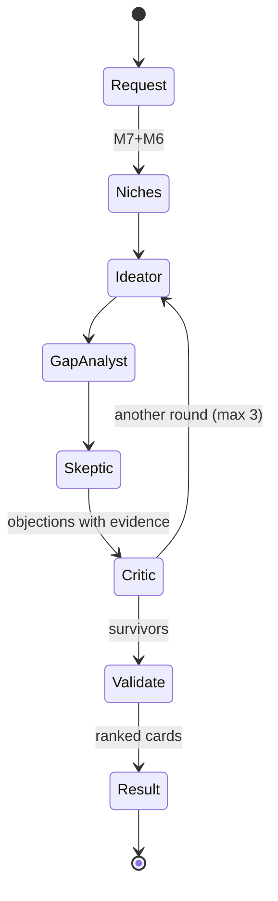
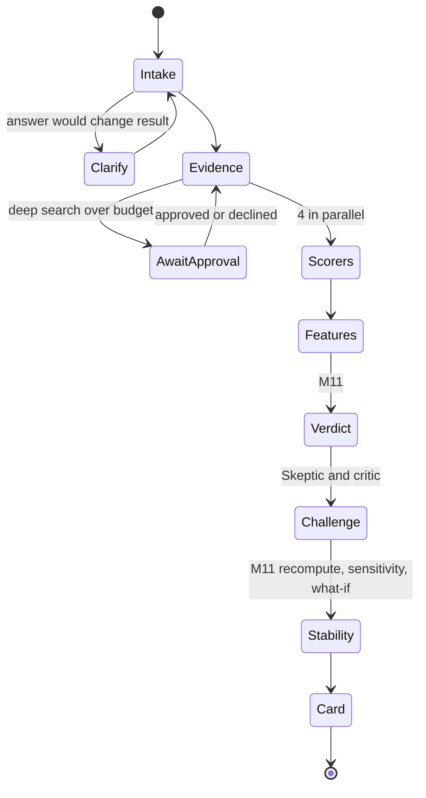
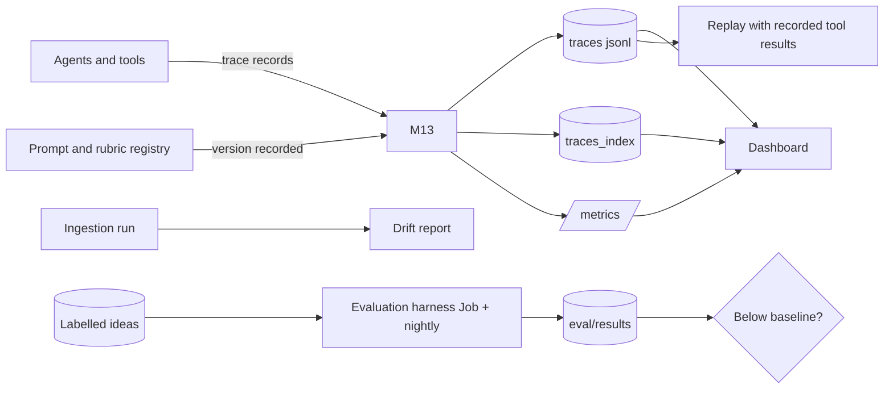

# Agent workflows

Proposed state machines (Description Figures 2 and 3).

## Discover

## Validate

Rules: the model scores, only M11 decides; bounded retries and timeouts; budgets on tokens, pages, steps and
cost; re-run only what changed; every transition traced; behaviour tests replay recorded responses.

## AgenticOps

