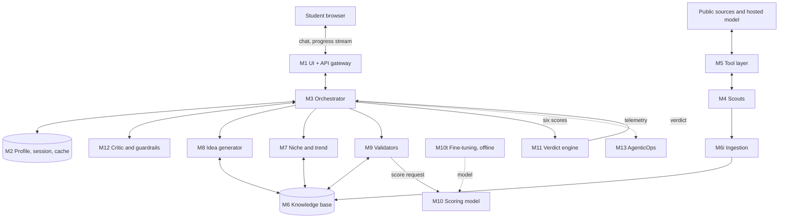
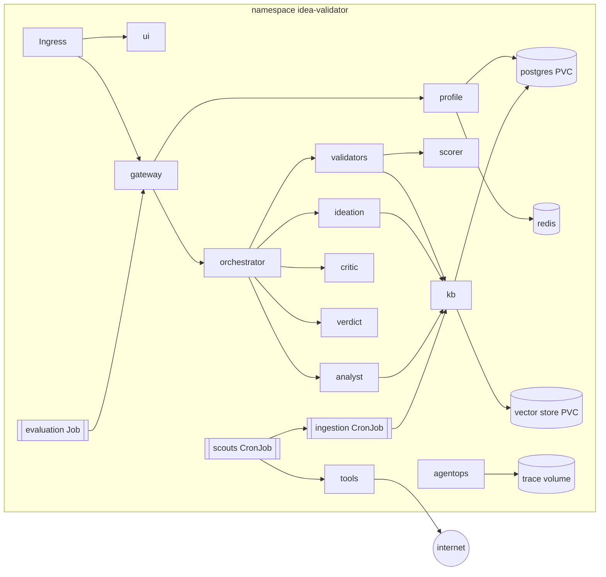

# Architecture

Status: proposed, derived from Description Figure 1. Deviations are listed at the end.

## High level

Every module sends telemetry to M13 (only one edge drawn).

## Containers

## Service communication
JSON over HTTP inside the cluster, validated against `contracts/schemas` on both sides; Server-Sent Events from
gateway to browser (decision proposed: SSE is one-way, which is all progress needs; answers and approvals are
POSTs). The browser calls only the gateway. Services call each other by Kubernetes DNS name from configuration.

## Cross-cutting
- Correlation: every call carries `run_id`; each step writes a trace record.
- Errors: typed JSON error, bounded retries with timeouts in M3; a failed scorer abstains, it never invents.
- Auth: M1 issues and checks user tokens; internal services trust only in-cluster traffic restricted by
  NetworkPolicy.
- Data ownership: [DataArchitecture](DataArchitecture.md).

## Deviations from Figure 1 (to be stated in the report)
1. M3 calls M11 and passes its result to M12; the figure draws M10→M11→M12 (AMB-21).
2. Hosted model calls leave through M5 (AMB-04, pending D-06).
