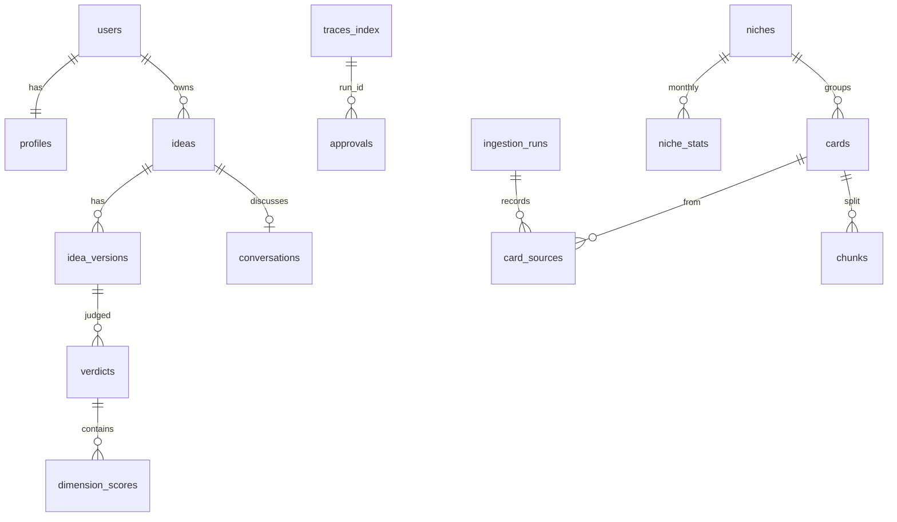
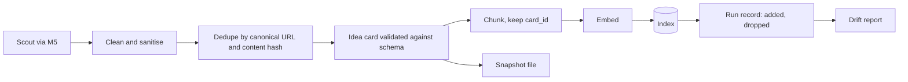

# Data architecture

Proposed, from Guide Figure 1 and section 2. Entity and migration details: `contracts/database/entities.md`.

`ingestion_runs → card_sources` is a proposed link; the source figure does not draw it.

| Store | Owner | Content |
|---|---|---|
| Postgres (application) | M2 | users, profiles, ideas, idea_versions, verdicts, dimension_scores, approvals, traces_index, conversations |
| Postgres (knowledge) | M6, M7 | cards, card_sources, niches, niche_stats, ingestion_runs |
| Vector store | M6 | chunk_id, card_id, embedding, date |
| Redis | M2 | cache entries only, with TTL (key: AMB-11) |
| Volumes | M13 | traces/*.jsonl, eval/results/*.json |
| Git | all | prompts/, rubrics/, config, labelled sets |

Rules: chunks keep card ids; every claim links to card ids; only public data; a card snapshot is kept.

## Ingestion pipeline

