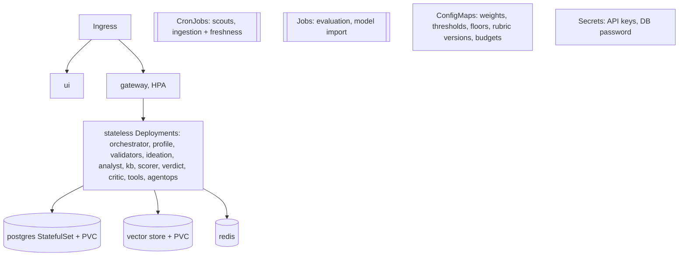

# Deployment, Docker and Kubernetes strategy

Status: proposed. Verified: the namespace and NetworkPolicy manifests pass schema validation, and Calico enforces
them on the local kind cluster ([test output](../evidence/phase1/netpol-test.txt)). No workload is deployed.

## Docker
- One image per module (AMB-03), multi-stage, non-root, pinned base (`python:3.12-slim` by digest) and
  dependencies, `.dockerignore`, `/health` and `/ready`, config from environment, no `localhost`.
- Tag = short commit SHA, never only `latest`. Registry proposed: GHCR. Scan with Trivy, fail on CRITICAL.
- Model weights go to a release asset or registry, never git.

## Kubernetes
Local `kind` with Calico, created by `scripts/cluster_up.sh` (alternative: minikube `--cni=calico`). Namespace
`idea-validator`.

Every workload: liveness and readiness probes, requests and limits from `kubectl top` measurements, non-root,
pinned image. `RollingUpdate`, `maxUnavailable: 0`, rollback with `kubectl rollout undo`. Traces to stdout as
JSON lines and to a volume.

Order of work: skeleton on the cluster in Phase 1; measurements, autoscaling and demonstrations in Phase 10.
