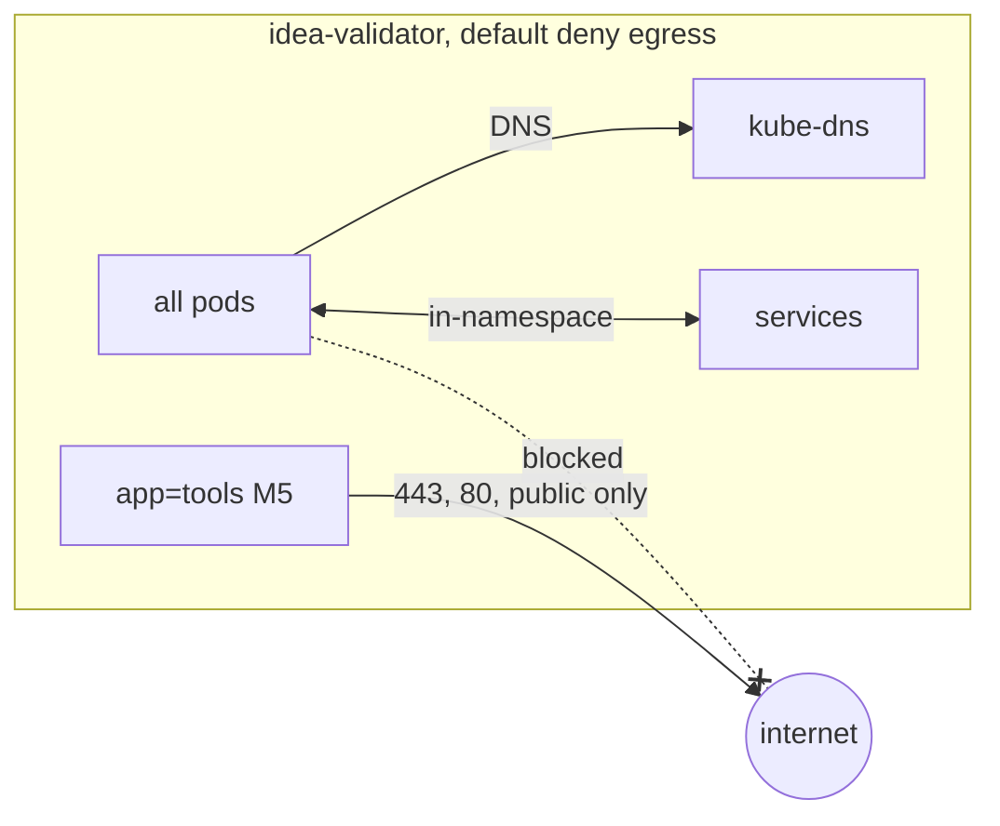

# Security architecture

Proposed.

| Threat | Control | Verification |
|---|---|---|
| Instructions hidden in fetched pages | M5 sanitiser; evidence passed as data in delimited fields; M12 claim check; models cannot set verdicts | poisoned-page test |
| Egress or SSRF | default-deny egress; only `app=tools`; domain allow-list; private ranges excluded; redirects re-checked | `scripts/netpol_test.sh` |
| Credential leak | names only in `.env.example`; Kubernetes Secrets; Jenkins credentials; secret scan and GitHub push protection | `secret-scan` |
| Abuse of public API | auth, rate limits, input validation, input rail | security tests |
| Overspend | budgets in orchestrator and tool layer; approval above budget | budget tests |
| Supply chain | actions pinned by SHA; tool downloads checksum-verified; scanner image pinned by digest (Trivy was compromised in March 2026, GHSA-69fq-xp46-6x23); dependency audit | CI |
| Vulnerable images | multi-stage, non-root, pinned; scan blocks CRITICAL | `image-scan` |
| Private data | public fields only; passwords hashed | review |

In-namespace egress is broad for every pod except the UI, whose egress is limited to DNS and the API
(`app: gateway`). There are no per-service ingress rules.
Trust limits of the development harness are in [PermissionPolicy](../agentic/PermissionPolicy.md).
