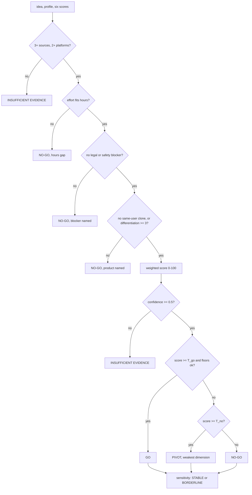

# Verdict engine specification (M11)

Specification only. Source: Description section 5. Defaults: `config/verdict.defaults.json`. Items marked
(proposed) depend on decision D-07.

## Inputs and outputs
Input: six dimension scores (or abstentions), profile, config, gate facts. Output: `verdict.schema.json`.
Pure function: no network, clock, randomness or model.

## Decision flow

## Formulas
- `score = sum(weight_i * score_i) / 5` (weights sum to 100).
- `confidence = 0.7 * mean(conf_i) + 0.3 * min(1, sources/5)`; below 0.5 abstain.
- Floors (1.5) apply to the first five dimensions.
- Challenge: accepted objection: score −0.5 (cap −1.0 per dimension), confidence −0.1 (proposed cap −0.2);
  clamp; recompute gates and score.
- Sensitivity: for each weight ×1.2 and ×0.8, redistribute the difference over the other weights in proportion
  (12 runs); least confident score ±1, clamped (2 runs). Any verdict change → BORDERLINE with the flipping runs.
- What would make GO (proposed): smallest total score increase in 0.5 steps, single dimensions then pairs,
  that yields a GO; report new score and verdict.
- Comparisons use unrounded values.

## Required unit tests
Each gate pass and fail edge; T_go and T_no at, above, below; floor at 1.5; confidence at 0.5; duplicate at
differentiation 3; challenge caps; each sensitivity direction; what-if; abstention; determinism; worked example
(70.5; 69.867 after Feasibility 25→20; 73.5; 73.067). See AMB-24 before asserting flip counts.
