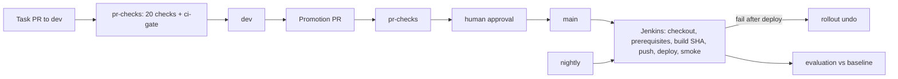

# CI/CD architecture



## Locked check names

| Check | Phase 0 | Activates / applies |
|---|---|---|
| repo-structure, requirements-registry, traceability, task-policy, branch-policy, protected-files, secret-scan, harness-tests | operational | always |
| lint, typecheck | operational for harness code | adds services and UI when code exists |
| contract-tests, k8s-validate, dependency-security | operational | always |
| verdict-unit-tests | not applicable | code under services/verdict, or gate P03 passed |
| backend-unit-tests, docker-build, image-scan | not applicable | service or job code, or gate P01 passed |
| ui-component-tests | not applicable | code under services/ui, or gate P01 passed |
| retrieval-gate | not applicable | retrieval tests or baseline, or gate P04 passed |
| agent-behaviour-tests | not applicable | behaviour tests, or gate P08 passed |
| ci-gate | operational | fails unless every job result is success |

"Not applicable" is printed with its reason; once applicable, missing code, tests, Dockerfile or baseline fails.
Rules live in `harness/policies/project.json` (protected). No `continue-on-error`; no job is skipped by
condition. Policy checks run with the base branch's checker, policy and task registry, and install nothing
from the pull request. The workflow file itself comes from the PR, so human review is the final control.

## Jenkins
Runs in a container next to the cluster. Start it (after `cluster_up.sh`) from Git Bash:

```sh
sh scripts/jenkins_up.sh          # polls dev; pass a branch name to poll another
```

Open <http://127.0.0.1:8085/job/idea-validator-delivery/>. Stop it with `docker stop scd-jenkins scd-registry`.

| Item | How |
|---|---|
| Trigger | SCM polling every 2 minutes, nightly timer (`Jenkinsfile`) |
| Stages | checkout, prerequisites, build, push, deploy, smoke test, nightly evaluation |
| Tags | `localhost:5001/<area>-<module>:<7-character commit>` |
| Registry | local `registry:3` container. For GHCR set `REGISTRY_OVERRIDE` and add the `registry` credential (untested) |
| Cluster access | in-network kubeconfig copied in by `jenkins_up.sh`, held as credential `kubeconfig-test` |
| Failure | before deployment nothing is deployed; after it, `rollback.sh` runs `rollout undo` on the changed Deployments |
| Demonstrate | build with parameter `FAIL_SMOKE` on a new commit |

Access: there are no accounts. The port is published on the loopback address only, where anyone may read and start
the job; containers on the `kind` Docker network can reach it too. Jenkins runs as root with the host Docker
socket, which gives it control of this machine's Docker. Image scanning stays in GitHub Actions (`image-scan`).
The nightly evaluation stage fails until `check_eval.sh` is implemented (P08.02). Rollback does not restore
ConfigMaps, replica counts or the CronJob image.
