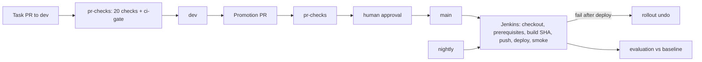

# CI/CD architecture

## Locked check names

| Check | Phase 0 | Activates / applies |
|---|---|---|
| repo-structure, requirements-registry, traceability, task-policy, branch-policy, protected-files, secret-scan, harness-tests | operational | always |
| lint, typecheck | operational for harness code | adds services and UI when code exists |
| contract-tests, k8s-validate, dependency-security | operational | always |
| verdict-unit-tests | not applicable | code under services/verdict, or gate P03 passed |
| backend-unit-tests, docker-build, image-scan | not applicable | service or job code, or gate P01 passed |
| ui-component-tests | not applicable | code under services/ui, or gate P01 passed |
| retrieval-gate | not applicable | retrieval tests or baseline, or gate P04 passed |
| agent-behaviour-tests | not applicable | behaviour tests, or gate P08 passed |
| ci-gate | operational | fails unless every job result is success |

"Not applicable" is printed with its reason; once applicable, missing code, tests, Dockerfile or baseline fails.
Rules live in `harness/policies/project.json` (protected). No `continue-on-error`; no job is skipped by
condition. Policy checks run with the base branch's checker, policy and task registry, and install nothing
from the pull request. The workflow file itself comes from the PR, so human review is the final control.

## Jenkins
`Jenkinsfile`: SCM polling every 2 minutes, nightly trigger. Without module images the build result is
`NOT_BUILT` and nothing is deployed. Failure before deployment deploys nothing. A release is applied once; any
failure after deployment starts (rollout, smoke test or evaluation) runs `rollback.sh`, which undoes only the
Deployments that run changed. Manifests name images `REGISTRY/<module>:RELEASE`. The scripts were exercised
against a fake `kubectl` only. Credentials by id only (`registry`, `kubeconfig-test`). Smoke and evaluation scripts exit 1 until
implemented. Validation status: see the Phase 0 verification report.
